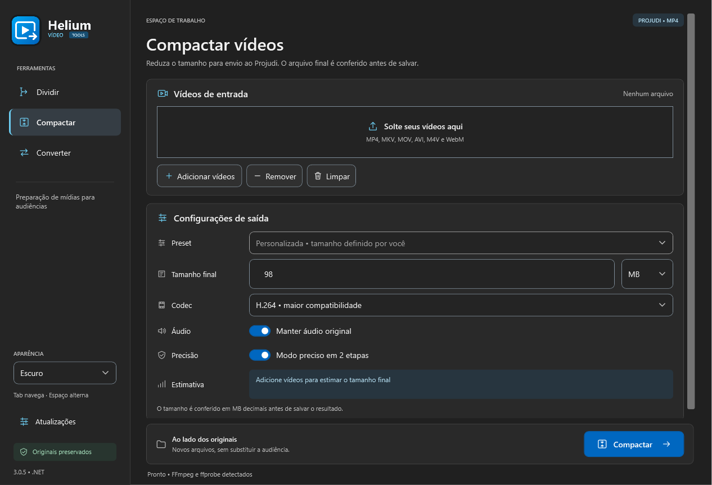

# Helium Vídeo Tools — C# / .NET 10 / WPF

Na **3.0.16**, desligar **Áudio original** em Compactar revela **Taxa de áudio** e **Canais**, com AAC de 64 a 320 kbps e orçamento ajustado à escolha. Padrão 128 kbps/manter canais; cópia original permanece ligada ao abrir. [Comportamento e testes](docs/AUDIO-SETTINGS.md).

Na **3.0.15**, o layout aprovado em dois painéis se adapta à janela nas três ferramentas, com drop em toda a área interna, seleção protegida durante processamento, progresso/resultado compactos e **Voltar ao início**. Área de soltar ampliada, botões iguais e Áudio/Precisão lado a lado. [Comportamento, testes e limites](docs/COMPACT-WORKSPACE.md).

[Desempenho medido da instalação 3.0.14](docs/DESEMPENHO-INSTALADO.md): abertura repetida mediana 727 ms; processamento real pela interface e memória simultânea com FFmpeg registrados, sem alterar o aplicativo. Primeira amostra não é garantia de cache frio.

Aplicativo Windows para preparar mídias de audiências: compactação e divisão para o Projudi, conversão para WebM para o SEEU. A implementação ativa está em **C#/.NET 10 com interface WPF**, na pasta `src`. O código Python anterior permanece como referência histórica da migração.

[Baixar instalador oficial — v3.0.14](https://github.com/HeliumMarcos/HeliumVideoTools/releases/tag/v3.0.14). Windows x64 por usuário, sem exigir administrador, com .NET e FFmpeg/ffprobe incluídos. Versões anteriores podem atualizar pelo aplicativo; o canal automático consulta apenas versões estáveis. Download com porcentagem, cancelamento e verificação SHA-256. Novas cópias na pasta Music foram dispensadas pelo usuário; a distribuição .NET permanece no GitHub.

Na 3.0.14, lotes interrompidos recuperam histórico, relatório e resumo das saídas publicadas ao reabrir, sem retomar codificação. Testes encerram worker real, verificam estados, bloqueio do lote ativo, saída alterada e repetição sem relatório duplicado. Teclado, UIA, alto contraste e renderização do resumo em quatro escalas integrados à validação. [Detalhes e limites](docs/BATCH-RECOVERY.md). O usuário deixou a escuta do Narrador pendente; DPI físico misto depende de ambiente apropriado.

Na 3.0.13, progresso e resultados emitem eventos acessíveis com controle de frequência, sem mudar o visual. Testes de teclado e cliente UIA separado confirmam navegação e recebimento. Corrigido o isolamento dos hosts WPF; as amostras antigas de abertura/memória são históricas, e uma nova referência exige uma janela. [Evidências e limites](docs/ACCESSIBLE-PROGRESS.md).

Na 3.0.12, a adaptação aprovada ajusta a janela à área útil e reorganiza campos/rolagem em espaços menores, preservando valores e restaurando o layout amplo ao aumentar. PerMonitorV2 declarado e nomes acessíveis adicionados aos botões de arquivos e ao progresso. [Prévia, testes e limites](docs/RESPONSIVE-ACCESSIBILITY.md).

Na 3.0.11, consulta inicial de atualização, controle da janela Atualizações e encerramento têm coordenadores próprios. Testes cobrem repetição de chamadas, cancelamento e salvamento antes de fechar. Reabertura imediata de Atualizações corrigida; layout preservado.

Na 3.0.10, o controle das estimativas foi separado da janela. Testes cobrem respostas atrasadas, cancelamento, alterações rápidas e fechamento; consulta com FFprobe real na janela padrão e mínima integra o GitHub. Visual, textos e padrões preservados.

Na 3.0.9, os campos das operações e a apresentação dos resultados foram separados da janela principal. Configuração, padrões e aparência foram preservados, com testes de caracterização e sete imagens de temas idênticas antes/depois. Consulte [a segunda etapa da organização interna](docs/REFACTOR-WINDOW.md).

Na 3.0.8, contratos e regras foram separados dos serviços de infraestrutura. Execução de processos e sondagem saíram do motor de vídeo, mantendo comandos, limites, caminhos e interface. Testes de arquitetura/funcionais e benchmark antes/depois verificam a separação; não há promessa de aceleração dos codecs.

Na 3.0.7, tentativas interrompidas de atualização das ferramentas têm registro próprio e recuperação do conjunto anterior/embutido. Se a substituição do app for interrompida no intervalo entre as pastas, executar o instalador novamente restaura a instalação anterior antes de continuar. Testes encerram processos em pontos controlados, sem desligar o computador.

Na 3.0.6, novos temporários são registrados para limpeza após interrupções, preservando originais e saídas concluídas. Os processos próprios de vídeo recebem proteção de ciclo de vida do Windows. A recuperação é feita em segundo plano e não retoma a codificação automaticamente. O layout permanece igual.

Na 3.0.5, a proposta visual aprovada adiciona Sistema/Claro/Escuro e alto contraste seguindo o Windows. A escolha persiste, as janelas mudam sem reiniciar e o foco de teclado fica mais visível. Os padrões de 98 MB e codecs continuam protegidos.

Na 3.0.4, a atualização das ferramentas permite retornar ao conjunto embutido após a primeira instalação e reparar o controle de ferramentas corrompido. Processamento e estimativas usam FFmpeg/ffprobe do mesmo conjunto capturado e validado. Testes de transação usam perfil isolado e executáveis reais, com transporte HTTP simulado.

Na 3.0.3, estimativas analisam metadados em segundo plano e distinguem orçamento, teto e referência por parte. Preferências úteis lembram pasta, janela e opções compatíveis, mas não substituem os padrões de abertura: Compactar, 98 MB, áudio original ligado e VP8.

Na 3.0.2, erros são tratados por arquivo, as saídas parciais concluídas são preservadas e o resumo final oferece relatório e seleção da pasta de saída. As divisões usam recodificação H.264/AAC em MP4 para cortes precisos; podem ser mais demoradas que copiar fluxos. Os originais permanecem intactos.



O tamanho é conferido antes de salvar. Compactação começa em 98 MB decimais; WebM usa o menor orçamento entre o teto informado e um valor abaixo do original. Os limites são configuráveis e não garantem aceitação pelos sistemas de destino, que podem ter outros requisitos.

O repositório é público; atualizações e downloads de Releases não exigem login nem token do usuário. O visual e a identidade A (Vídeo em movimento) foram aprovados. Consulte [andamento e pendências](docs/MIGRACAO-ANDAMENTO.md) e [plano](docs/PLANO-MIGRACAO.md). O instalador .NET é produzido pelo GitHub Actions e publicado em [Releases](https://github.com/HeliumMarcos/HeliumVideoTools/releases), sem exigir administrador. Uma build não deve ser descrita como estável antes da validação da distribuição.

## Desenvolvimento .NET

Estrutura interna: `Core` contém contratos/modelos e regras; `Infrastructure` implementa FFmpeg/ffprobe, processos, atualizações, recuperação, preferências, relatórios e logs; `Desktop` compõe os serviços e a interface WPF; `UpdateHost` auxilia o instalador. A infraestrutura referencia Core, e o núcleo não referencia a interface nem a infraestrutura. Consulte [separação e validação](docs/REFACTOR-INFRASTRUCTURE.md) e [medições antes/depois](docs/DESEMPENHO.md).

```powershell
dotnet build src/HeliumVideoTools.Desktop -c Release
.\scripts\Prepare-MediaTools.ps1
dotnet run --project tests/HeliumVideoTools.Tests -c Release
dotnet run --project src/HeliumVideoTools.Desktop
```

Requer SDK .NET 10. FFmpeg e ffprobe são preparados juntos, com versão/hash fixados em `tools/manifest.json`. Os binários não acompanham o Git. A distribuição self-contained inclui runtime e ferramentas.

## Referência histórica Python 2.6

Os comandos abaixo são da distribuição anterior; não geram o aplicativo .NET.

## Executar em desenvolvimento

```powershell
python -m pip install -r requirements.txt
python main.py
```

Os logs JSON rotativos ficam em `%APPDATA%\HeliumVideoTools\helium_video_tools.log`.

## Testar e empacotar

```powershell
python -m unittest discover -s tests -v
.\build.ps1
```

O script gera duas distribuições:

- `C:\Users\HeliumMarcos\Downloads\Music\HeliumVideoTools.exe`: versão portátil em um único arquivo.
- `C:\Users\HeliumMarcos\Downloads\Music\HeliumVideoTools-Rapido\HeliumVideoTools.exe`: versão `onedir`, que abre mais rápido porque não precisa extrair o runtime Qt a cada execução.

O build usa Python 3.12 para estabilidade do runtime Qt. O FFprobe separado foi eliminado; a análise usa o próprio FFmpeg.

## Assinatura digital opcional

Com um certificado de code signing instalado, assine antes de distribuir:

```powershell
signtool sign /fd SHA256 /tr http://timestamp.digicert.com /td SHA256 /a dist\HeliumVideoTools.exe
signtool verify /pa dist\HeliumVideoTools.exe
```

Um certificado EV reduz avisos do SmartScreen mais rapidamente; certificados OV também são válidos, mas constroem reputação ao longo do tempo.
