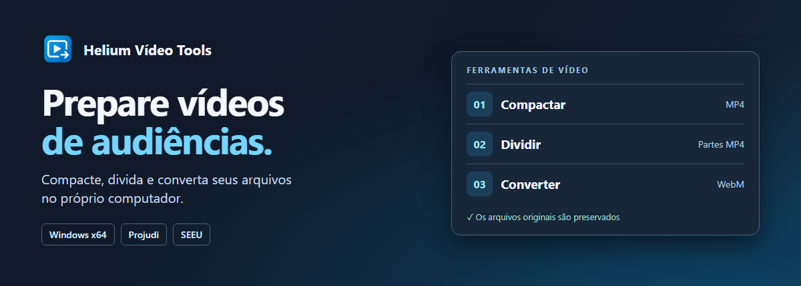
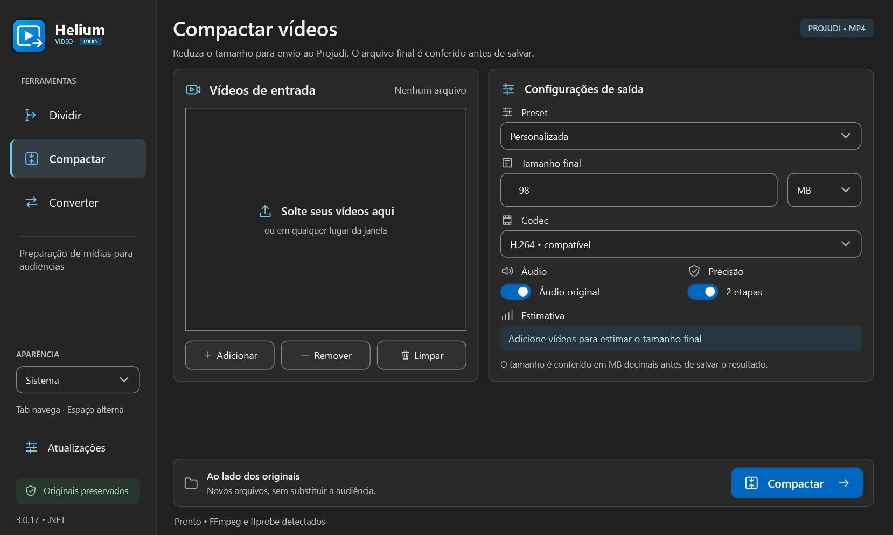

  

# Helium Vídeo Tools

  <a href="https://github.com/HeliumMarcos/HeliumVideoTools/releases/latest"><strong>Baixar para Windows</strong></a>
  · <a href="#como-usar">Como usar</a>
  · <a href="#documentação">Documentação</a>
  · <a href="CONTRIBUTING.md">Contribuir</a>

Aplicativo para **compactar, dividir e converter vídeos de audiências** no próprio computador. Solte os arquivos na janela, escolha a operação e acompanhe o progresso. Os resultados ficam ao lado dos originais.

  
Ver a interface do aplicativo

  

  Captura da versão 3.0.17, na tela Compactar.

## Instalação e atualização

1. Na [versão estável mais recente](https://github.com/HeliumMarcos/HeliumVideoTools/releases/latest), baixe o arquivo terminado em **-win-x64-Setup.exe**.
2. Abra o instalador em um Windows de 64 bits. A instalação é por usuário, com .NET, FFmpeg e ffprobe incluídos.
3. Para atualizar, abra **Atualizações → Verificar versão**. O app baixa o instalador e verifica seu SHA-256 antes de executá-lo. A atualização usa a mesma pasta.

## Como usar

| Ferramenta | Resultado | Padrão inicial |
| --- | --- | --- |
| **Compactar** | MP4 para o Projudi | 98 MB, H.264 e áudio original |
| **Dividir** | Partes MP4 por tamanho, quantidade ou duração | Divisão por tamanho, até 98 MB por parte |
| **Converter** | WebM para o SEEU | VP8, áudio Opus e teto de 299 MB |

1. **Adicione os vídeos** pelo botão **Adicionar** ou solte-os na área interna da janela.
2. **Confira as opções e a estimativa.** Em Compactar, desmarque **Áudio original** para escolher a taxa AAC e os canais. Em Converter, o app ajusta o orçamento para ficar abaixo do tamanho do original.
3. **Execute a operação.** Acompanhe o progresso e, ao terminar, use **Abrir pasta**, **Ver relatório** ou **Voltar ao início**.

O tamanho usa MB decimais. Nas operações com teto, o arquivo é conferido antes de ser publicado. O envio é feito por você no sistema de destino, que pode aplicar critérios adicionais.

## Arquivos e privacidade

O processamento de vídeo é local. O aplicativo acessa a internet para consultar e baixar atualizações do programa e das ferramentas. Preferências, logs e relatórios ficam em **%LOCALAPPDATA%\HeliumVideoTools**. Ao pedir suporte, use mídia sintética e revise os logs antes de anexá-los, pois podem conter nomes e caminhos de arquivos.

## Documentação

| Quero saber sobre | Onde consultar |
| --- | --- |
| Novidades por versão | [Notas de versão](docs/RELEASE-NOTES.md) |
| Interface e ajustes de áudio | [Interface compacta](docs/COMPACT-WORKSPACE.md) · [Configuração de áudio](docs/AUDIO-SETTINGS.md) |
| Recuperação após interrupções | [Recuperação de lotes](docs/BATCH-RECOVERY.md) |
| Código, compilação e testes | [Guia de contribuição](CONTRIBUTING.md) |
| Migração e desempenho | [Histórico da migração](docs/MIGRACAO-ANDAMENTO.md) · [Medições](docs/DESEMPENHO-INSTALADO.md) |
| Segurança e convivência | [Política de segurança](SECURITY.md) · [Código de conduta](CODE_OF_CONDUCT.md) |
| Licenças distribuídas | [Guia em português](installer/LICENCAS.pt-BR.txt) · [Texto original do FFmpeg](FFmpeg-LICENSE.txt) |

Dúvidas e sugestões podem ser registradas nos [Issues do projeto](https://github.com/HeliumMarcos/HeliumVideoTools/issues).
