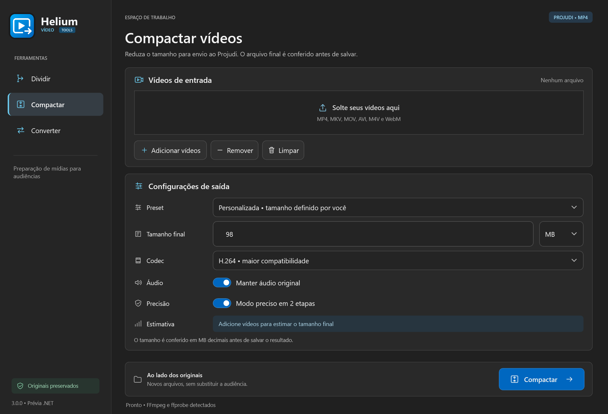

# Helium Vídeo Tools — C# / .NET 10 / WPF

Aplicativo Windows para preparar mídias de audiências: compactação e divisão para o Projudi, conversão para WebM para o SEEU. A implementação ativa está em **C#/.NET 10 com interface WPF**, na pasta `src`. O código Python anterior permanece como referência histórica da migração.



O tamanho é conferido antes de salvar. Compactação começa em 98 MB decimais; WebM usa o menor orçamento entre o teto informado e um valor abaixo do original. Os limites são configuráveis e não garantem aceitação pelos sistemas de destino, que podem ter outros requisitos.

O visual e a identidade A (Vídeo em movimento) foram aprovados pelo usuário. Consulte [andamento e pendências](docs/MIGRACAO-ANDAMENTO.md) e [plano](docs/PLANO-MIGRACAO.md). O instalador .NET será produzido pelo GitHub Actions e publicado em [Releases](https://github.com/HeliumMarcos/HeliumVideoTools/releases), sem exigir administrador. Uma build não deve ser descrita como estável antes da validação da distribuição.

## Desenvolvimento .NET

```powershell
dotnet build src/HeliumVideoTools.Desktop -c Release
.\scripts\Prepare-MediaTools.ps1
dotnet run --project tests/HeliumVideoTools.Tests -c Release
dotnet run --project src/HeliumVideoTools.Desktop
```

Requer SDK .NET 10. FFmpeg e ffprobe são preparados juntos, com versão/hash fixados em `tools/manifest.json`. Os binários não acompanham o Git. A distribuição self-contained inclui runtime e ferramentas.

## Referência histórica Python 2.6

Os comandos abaixo são da distribuição anterior; não geram o aplicativo .NET.

## Executar em desenvolvimento

```powershell
python -m pip install -r requirements.txt
python main.py
```

Os logs JSON rotativos ficam em `%APPDATA%\HeliumVideoTools\helium_video_tools.log`.

## Testar e empacotar

```powershell
python -m unittest discover -s tests -v
.\build.ps1
```

O script gera duas distribuições:

- `C:\Users\HeliumMarcos\Downloads\Music\HeliumVideoTools.exe`: versão portátil em um único arquivo.
- `C:\Users\HeliumMarcos\Downloads\Music\HeliumVideoTools-Rapido\HeliumVideoTools.exe`: versão `onedir`, que abre mais rápido porque não precisa extrair o runtime Qt a cada execução.

O build usa Python 3.12 para estabilidade do runtime Qt. O FFprobe separado foi eliminado; a análise usa o próprio FFmpeg.

## Assinatura digital opcional

Com um certificado de code signing instalado, assine antes de distribuir:

```powershell
signtool sign /fd SHA256 /tr http://timestamp.digicert.com /td SHA256 /a dist\HeliumVideoTools.exe
signtool verify /pa dist\HeliumVideoTools.exe
```

Um certificado EV reduz avisos do SmartScreen mais rapidamente; certificados OV também são válidos, mas constroem reputação ao longo do tempo.
