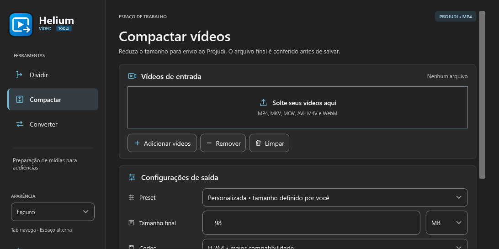
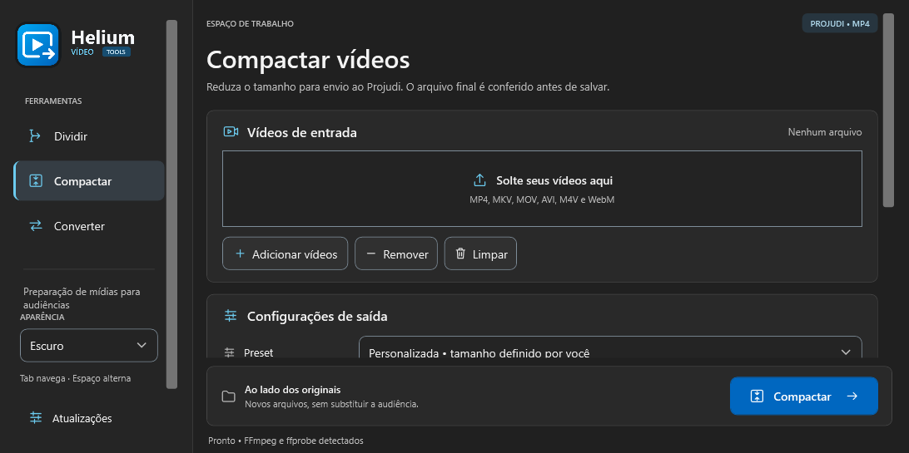
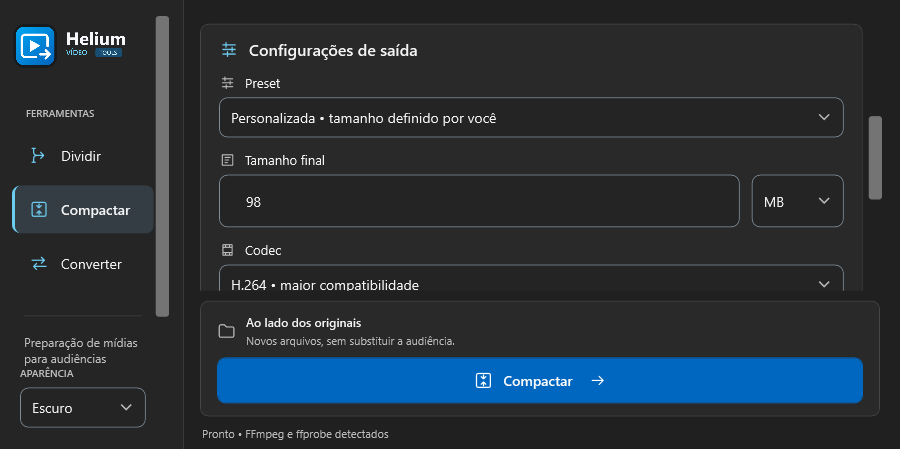
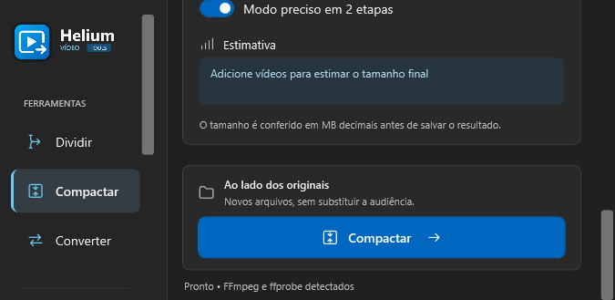

# Telas e acessibilidade — etapa 3.0.12

Em 02/11/2026, a comparação antes/depois foi apresentada e o usuário respondeu **Aprovar e integrar**. Também dispensou novas cópias do instalador na pasta Music; distribuição permanece nas Releases do GitHub.

## Auditoria inicial

O mínimo de 980×700 DIPs e as dimensões restauradas podem ultrapassar áreas úteis menores. Em cinco áreas lógicas e três operações, o botão de ação ficou fora do recorte nas quatro áreas menores. A auditoria por AutomationPeer encontrou nomes vazios nos botões Adicionar/Remover/Limpar. O host inicial estava em System DPI. Registro anterior às correções em [responsive/audit-3.0.11.json](responsive/audit-3.0.11.json).

Atual e proposta aprovada, na mesma área de 1092×545 DIPs de conteúdo:

Campos em área estreita e ação após rolagem numa área extremamente baixa:

## Integração

- ResponsiveLayout reorganiza os mesmos controles, sem reconstruir o editor ou perder valores. Acima de 1100×700 de conteúdo, preserva o layout amplo. Abaixo de 1000 de largura, os rótulos ficam acima dos campos e a ação ocupa outra linha. Abaixo de 980, a lateral ocupa 184 em vez de 232 DIPs.
- Lateral/formulário rolam conforme necessário. Abaixo de 420 de altura, ou 600 com progresso visível, rola o espaço de trabalho inteiro para manter a ação alcançável. Não se promete que todo o formulário apareça simultaneamente num espaço pequeno.
- Mudanças de tamanho/visibilidade são agrupadas no Dispatcher antes do render; rolagem desanexada termina a atualização visual antes de recolocar os controles. O teste de ida/volta detectou e motivou essa proteção de reparenting.
- WindowWorkArea usa limites nativos do monitor em pixels e o DPI da janela, ajustando dimensões/posição sem ativar ou trocar a ordem das janelas. Reage à criação, carga, DPI, mudança de monitor, restauração e notificações de área de trabalho. Também é usado em Atualizações; o tamanho padrão continua igual, mas janelas pequenas podem precisar de rolagem.
- Manifesto asInvoker mantém execução por usuário normal e declara PerMonitorV2. O host WPF de testes usa o mesmo manifesto e confirma o contexto real.
- Nomes acessíveis explícitos adicionados aos botões de arquivos e à barra geral; textos e parâmetros de vídeo preservados.

## Verificação e limites

`--audit-responsive <pasta>` executa 30 comparações (cinco áreas × três operações × atual/adaptado). A ação adaptada é alcançável nos 15 casos. Exercita ainda 36 combinações de operação/idle/progresso/resultado/tamanho em reflow de ida e volta, preservando valor, unidade e instância dos campos. Compara o conteúdo padrão por SHA-256. Uma janela própria maior e fora da tela é ajustada à área útil real, sem mudar o monitor.

As áreas lógicas são 1280×860, 1092×545, 900×449, 952×485 e 675×329. Esses testes modelam pressão de espaço, não alteram a escala real do Windows. Ainda faltam os testes físicos em 100/125/150/200%, movimentação entre monitores com DPI diferente, Narrador e anúncios de progresso sem excesso. LiveSetting existente, por si só, não comprova anúncio pelo leitor. Não houve garantia nova de conformidade/aceitação no Projudi/SEEU.

Referências técnicas: [manifestos e DPI](https://learn.microsoft.com/windows/win32/hidpi/setting-the-default-dpi-awareness-for-a-process), [exemplo WPF oficial](https://github.com/microsoft/WPF-Samples/blob/main/PerMonitorDPI/readme.md), [eventos de região dinâmica no WPF](https://learn.microsoft.com/accessibility-tools-docs/items/wpf/text_livesetting). A skill UI/UX Pro Max forneceu recomendações de foco não encoberto e layout/DPI WPF; os resultados sobre WCAG Web orientaram a revisão, sem declarar certificação do aplicativo desktop.
